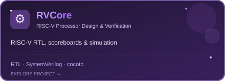
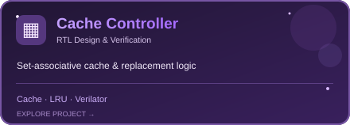
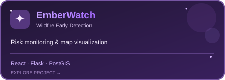
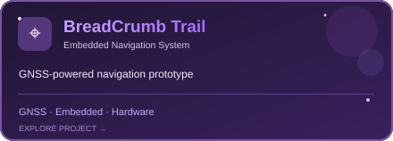
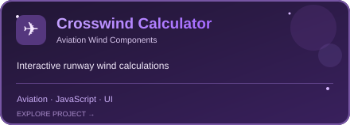
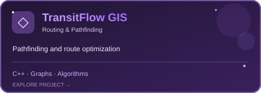

# ✨ Hey, I'm Riana!

**Computer Engineering @ University of Toronto**  
*Interests: Hardware · Embedded Systems · Robotics · Aviation ✈️*

*From circuits to code to the skies — I love turning ideas into things that work.*

---

### 🛠️ My toolkit

**Hardware & verification**  
    

**Software & tools**  
    

### 🌌 Featured projects

| | |
|:--:|:--:|
|  |  |
|  |  |
|  |  |

---

**Thanks for stopping by — see you among the stars! ✨**

